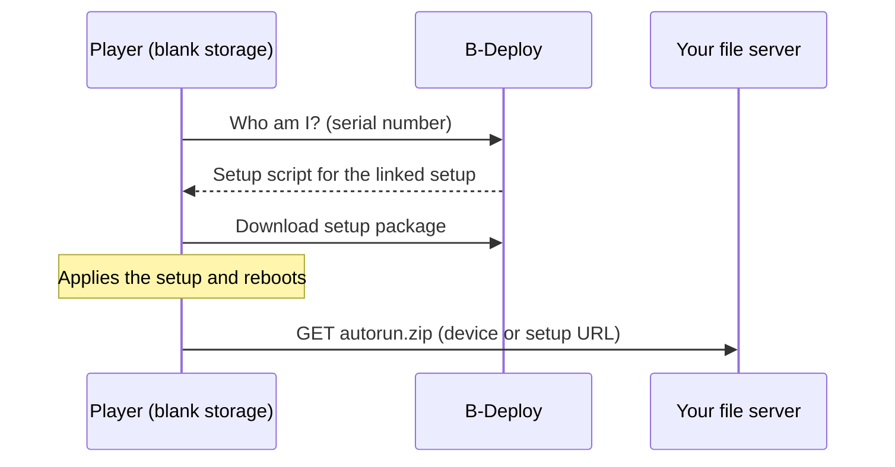
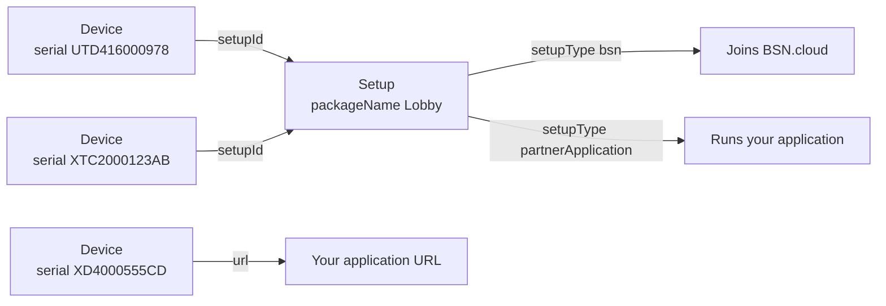

# B-Deploy API: developer guide and migration kit

B-Deploy is BrightSign's cloud provisioning service. When a BrightSign player starts with
blank storage, it asks B-Deploy what it should be. B-Deploy answers with a **setup**:
networking, diagnostics, firmware policy, and either a BSN.cloud registration or the URL
of your application. The player applies it, reboots, and runs.

This repository gives you what you need to automate B-Deploy from your own systems:

- a practical guide to the current API (device API v2, setup API v3);
- a step-by-step guide for moving an existing v1 integration;
- OpenAPI 3.0 specifications you can browse or feed to a code generator;
- a ready-to-run Python test client that checks your credentials and exercises the API;
- an AI coding assistant skill that applies all of this to your code ([install it](#ai-coding-assistant-skill));
- connection details for the [BrightDeveloper MCP server](#brightdeveloper-mcp-server), which lets an assistant search BrightSign's developer docs;
- a pointer to [GoPurple](#gopurple-go-sdk-and-reference-implementation), BrightSign's Go SDK for all of BrightSign Control.

## Where to start

| You want to… | Read or run |
|---|---|
| Check that your credentials and network work | [Verify your access](#1-verify-your-access) (about a minute) |
| Build a new integration | [`docs/BDEPLOY-API-GUIDE.md`](docs/BDEPLOY-API-GUIDE.md) |
| Move a v1 integration to v2/v3 | [`docs/MIGRATION-v1-to-v2.md`](docs/MIGRATION-v1-to-v2.md) |
| See a working client to copy from | [`src/`](src/README.md): Python, standard library only |
| Generate client code or browse the API | [`swagger/bdeploy-v2-v3.yaml`](swagger/bdeploy-v2-v3.yaml) and [`swagger/bsn-main-provisioning.yaml`](swagger/bsn-main-provisioning.yaml) |
| Have an AI coding assistant port or review your client code | [AI coding assistant skill](#ai-coding-assistant-skill) |
| Let your AI assistant search BrightSign's developer docs | [BrightDeveloper MCP server](#brightdeveloper-mcp-server) |
| Use a Go SDK for all of BrightSign Control, not only B-Deploy | [GoPurple](#gopurple-go-sdk-and-reference-implementation) |

## AI coding assistant skill

The repository includes a skill for AI coding assistants. It gives your assistant the
B-Deploy wire contract and every pitfall in this repository, so it can port a v1 client,
write a new v2/v3 client, or review existing client code in any language. It also
reports changes your callers will notice, such as the move from a user name and password
to API client credentials.

The skill is the folder `skills/migrating-bdeploy-v1-to-v2/`. It holds a single
`SKILL.md` in the Agent Skills format: Markdown with `name` and `description`
front-matter. **To install it, follow the instructions for installing skills in your
preferred agent.** If your agent does not support skills, give it the contents of
`SKILL.md` as project instructions instead. The rules are plain text and need no special
tooling.

For example, in Claude Code you copy the folder into a project's `.claude/skills/`
directory (or `~/.claude/skills/` for every project). Then start a new session and either
ask in plain words, such as *"migrate our B-Deploy client to the v2/v3 API"*, or type
`/migrating-bdeploy-v1-to-v2`.

To update the skill, copy the folder again over the old one.

## BrightDeveloper MCP server

BrightSign runs a Model Context Protocol (MCP) server that lets an AI assistant search
BrightSign's developer documentation while it works. Topics include BrightScript, HTML5
player apps, BrightSignOS, the BSN.cloud APIs and the `gopurple` Go SDK. Use it together
with the skill above. The skill carries the B-Deploy rules, and the MCP server answers
the wider BrightSign questions that come up around them.

| Setting | Value |
|---|---|
| URL | `https://brightdeveloper-mcp.bsn.cloud/mcp` |
| Transport | Streamable HTTP |
| Authentication | None |
| Tools | `search_docs` (semantic search), `list_available_documents`, `get_document_content` |

**To connect, follow your agent's instructions for adding a remote (HTTP) MCP server.**
Most agents accept a configuration entry like this:

```json
{
  "mcpServers": {
    "brightdeveloper": {
      "type": "http",
      "url": "https://brightdeveloper-mcp.bsn.cloud/mcp"
    }
  }
}
```

For example, in Claude Code:

```bash
claude mcp add brightdeveloper --transport http https://brightdeveloper-mcp.bsn.cloud/mcp
```

Then start a new session and ask a BrightSign question, for example *"search the
BrightDeveloper docs for how a player fetches its setup"*.

**Where the two disagree on B-Deploy, this repository wins.** The documentation index
includes the `gopurple` SDK's B-Deploy pages, and some of their statements about the API
are wrong. The corrections are listed in
[section 15 of the guide](docs/BDEPLOY-API-GUIDE.md#15-notes-on-the-gopurple-b-deploy-docs).
For example, device reads never return `setupId`, and updates take the id in the request
body, not in `?_id=`.

## GoPurple: Go SDK and reference implementation

[GoPurple](https://github.com/BrightDevelopers/gopurple) is BrightSign's Go SDK and
reference implementation for BrightSign Control (formerly BSN.cloud). It goes well beyond
B-Deploy and covers:

- **Authentication:** OAuth2 client credentials and network selection, with token
  handling built in.
- **Main REST API:** players, groups, subscriptions and registration tokens.
- **Remote DWS:** player info, health, logs, crash dumps, screenshots, registry, files,
  network diagnostics, reboot and re-provisioning.
- **B-Deploy:** setups and device records.

It also ships more than 60 example command-line programs, one per operation. You can
use them directly in scripts or read them as worked examples. GoPurple reads the same
`BS_CLIENT_ID`, `BS_SECRET` and `BS_NETWORK` variables as this repository.

```bash
go get github.com/brightdevelopers/gopurple@v0.2.4
```

```go
client, err := gopurple.New() // reads BS_CLIENT_ID and BS_SECRET
if err != nil {
    log.Fatal(err)
}
if err := client.Authenticate(ctx); err != nil {
    log.Fatal(err)
}
devices, err := client.Devices.List(ctx, nil)
```

To build the example programs, clone the repository and run `make build`. The
binaries land in `bin/`; for example, `./bin/bdeploy-list-setups` and
`./bin/rdws-snapshot --serial <SERIAL>`. Check the
[releases](https://github.com/BrightDevelopers/gopurple/releases) for the latest version
before pinning.

**Using GoPurple for B-Deploy:** as of commit `4bc27aa` (after `v0.2.4`), its B-Deploy
service has gaps that this repository documents. Name filters are ignored, page size is
never sent (so large lists come back truncated), setup lists drop `setupJson`, and
updates send partial records. Apply the workarounds in
[section 15 of the guide](docs/BDEPLOY-API-GUIDE.md#15-notes-on-the-gopurple-b-deploy-docs),
or call B-Deploy directly as the guide and the [Python test client](src/README.md) do.
The AI coding assistant skill knows these gaps too.

## What you need

| Item | Where it comes from |
|---|---|
| **API client id and secret** | Create an API client in BSN.cloud. B-Deploy acts as the client's owner, so the owning account must be a user in the network you will provision into. |
| **Network name** | Exactly as BSN.cloud shows it; case and spaces matter. |
| **Account e-mail** | The BSN.cloud user name. Needed to create setups and register players. |
| **Registration-token scope** (optional) | `bsn.api.main.devices.setups.token.create` on the API client. Needed only for setups whose players join BSN.cloud. |

Every example in this repository reads these from the same environment variables:

```bash
export BS_CLIENT_ID='<API client id>'
export BS_SECRET='<API client secret>'
export BS_NETWORK='<network name>'
export BS_USERNAME='<account e-mail>'
```

Optional variables:

| Variable | Default | Used for |
|---|---|---|
| `BS_TEST_SERIAL` | random `ZZ` + 10 hex characters | Serial the test client's lifecycle run registers and removes |
| `BS_TEST_URL` | `https://example.com/bdeploy-test-client/autorun.zip` | Application URL in the lifecycle run's temporary setup |
| `BS_AUTH_URL`, `BS_API_URL`, `BS_PROVISION_URL` | `https://auth.bsn.cloud`, `https://api.bsn.cloud`, `https://provision.bsn.cloud` | Pointing the test client at a non-production environment |

Keep the secret out of source control. Put these lines in an untracked `.env` or `.envrc`
(both are already in this repository's `.gitignore`).

## 1. Verify your access

Run the test client's read-only check before writing any code. It changes nothing. It
gets a token, selects your network, reads the selection back, and lists your setups and
players:

```bash
make -C src live-check
```

```text
PASS  get access token -- scopes: ...
PASS  select session network -- 'mynetwork' selected (204)
PASS  read session network back -- id=32776 name='mynetwork'
PASS  list setups -- 5 setup(s) on first page; server='Kestrel' (C#)
PASS  list devices -- 5 device(s) on first page
```

You need Python 3.10 or later and `make`; there is nothing to install. If a step fails,
look the message up in the guide's [Troubleshooting](docs/BDEPLOY-API-GUIDE.md#13-troubleshooting)
table. The same check as plain `curl` commands is in
[Prerequisites and live check](docs/BDEPLOY-API-GUIDE.md#4-prerequisites-and-live-check).

To exercise the write API end to end, run `make -C src lifecycle`. It creates a temporary
setup and player record, reads, updates and verifies them, then deletes them again. See
[`src/README.md`](src/README.md) for what it touches and how it cleans up.

## 2. Provision a player in four calls

These commands use `curl` and `jq`.

**Get an access token.** Tokens last about 5.5 minutes and cannot be refreshed; request a
new one when it expires.

```bash
TOKEN=$(curl -s https://auth.bsn.cloud/realms/bsncloud/protocol/openid-connect/token \
  -u "$BS_CLIENT_ID:$BS_SECRET" -d grant_type=client_credentials | jq -r .access_token)
```

**Select your network.** B-Deploy takes the network from your token's session, not from
the request. Expect HTTP `204`. Repeat this after every new token.

```bash
curl -s -o /dev/null -w '%{http_code}\n' -X PUT \
  https://api.bsn.cloud/2022/06/REST/Self/Session/Network \
  -H "Authorization: Bearer $TOKEN" -H 'Accept: application/json' \
  -H 'Content-Type: application/json' -d "{\"name\":\"$BS_NETWORK\"}"
```

**Create a setup.** This one points players at your application. It returns
`{"error":null,"result":"<setupId>"}`.

```bash
SETUP_ID=$(curl -s -X POST https://provision.bsn.cloud/rest-setup/v3/setup \
  -H "Authorization: Bearer $TOKEN" -H 'Accept: application/json' \
  -H 'Content-Type: application/json' -d @- <<EOF | jq -r .result
{
  "version": "3.0.0",
  "setupType": "partnerApplication",
  "bDeploy": {
    "username": "$BS_USERNAME",
    "networkName": "$BS_NETWORK",
    "packageName": "Lobby setup",
    "url": "https://cms.example.com/bdeploy/autorun.zip"
  },
  "bsnGroupName": "Default",
  "lwsEnabled": false,
  "remoteDwsEnabled": false
}
EOF
)
```

**Register a player** by serial number (12 characters, upper case). It returns
`{"error":null,"result":"<deviceId>"}`.

```bash
curl -s -X POST https://provision.bsn.cloud/rest-device/v2/device \
  -H "Authorization: Bearer $TOKEN" -H 'Accept: application/json' \
  -H 'Content-Type: application/json' -d @- <<EOF
{"serial": "UTD416000978", "username": "$BS_USERNAME", "NetworkName": "$BS_NETWORK",
 "name": "Lobby", "setupId": "$SETUP_ID"}
EOF
```

Power the player on with blank storage and it provisions itself:



## Key concepts



- **Setup:** a reusable player configuration, named by `bDeploy.packageName`. One
  setup serves any number of players.
- **Device:** one player serial number, registered in one network. It is linked to a
  setup (`setupId`) or points straight at an application (`url`). A serial can be
  registered in only one network at a time.
- **Setup type** decides what the player does after provisioning:

  | `setupType` | The player… |
  |---|---|
  | `partnerApplication` | downloads and runs your application from `bDeploy.url` |
  | `bsn` | joins BSN.cloud and is managed from there (needs a registration token) |
  | `sfn` | pulls content from a web folder (Simple File Networking) |
  | `lfn` | receives content over the local network (Local File Networking) |
  | `standalone` | runs local content |

- **Hosts:** tokens come from `auth.bsn.cloud`, network selection and registration
  tokens from `api.bsn.cloud`, and all B-Deploy calls go to `provision.bsn.cloud`.

## Things that catch people out

Read these before writing a client. The guide has the details, and its
[pitfalls checklist](docs/BDEPLOY-API-GUIDE.md#14-pitfalls-checklist) is a good code-review
list.

- **Send `Accept: application/json` and your own `User-Agent` on every call.** Without
  `Accept`, the network-selection call answers `300` and silently does nothing. Some
  default library agents, including Python's `Python-urllib`, are blocked with
  `403 error code: 1010`.
- **Check the `error` field, not only the status.** Every response is
  `{"error": ..., "result": ...}`, and some errors arrive with HTTP 200. Treat any
  non-2xx, including 3xx, as a failure.
- **Select the network after every new token.** Without it, B-Deploy calls fail, often
  with an empty `403`.
- **Defaults switch features on.** A new setup gets the Local Web Server, remote
  diagnostics and BSN.cloud turned on unless you send `false`.
- **Setups come back in two shapes.** A list returns records holding the setup as a JSON
  *string* in `setupJson`. `GET /setup/{id}` returns a *one-element array*.
- **Device reads never include `setupId`.** Use `setupName`. Put `setupId` back before
  every device update, or the player loses its link.
- **Always send complete records on PUT.** A partial body can erase the fields you left
  out. Read, modify, then write the whole record.
- **Filter setups with `query[packageName]=`.** A plain `?packageName=` is ignored and
  returns everything. Name filters can match partially, so compare names exactly in your
  code, and expect duplicates in older data.
- **Always pass `NetworkName` and `pageSize`.** A device list with no filter is empty,
  and page sizes default differently between environments.
- **Upper-case serial numbers.** Matching is case-sensitive.
- **Account names containing `brightsign`, `bsn` or `bacon`** need a registration
  token on every setup, whatever the setup type.

## Repository contents

| Path | Contents |
|---|---|
| [`docs/BDEPLOY-API-GUIDE.md`](docs/BDEPLOY-API-GUIDE.md) | The current API: authentication, every call, the setup field reference, workflows, troubleshooting |
| [`docs/MIGRATION-v1-to-v2.md`](docs/MIGRATION-v1-to-v2.md) | Porting a v1 client: authentication, paths, behaviour changes, field-by-field setup mapping |
| [`docs/IMPLEMENTATION-NOTES.md`](docs/IMPLEMENTATION-NOTES.md) | Background on how the specs were produced and how server behaviour varies |
| [`swagger/bdeploy-v2-v3.yaml`](swagger/bdeploy-v2-v3.yaml) | OpenAPI 3.0: device API v2, setup API v2 and v3 |
| [`swagger/bsn-main-provisioning.yaml`](swagger/bsn-main-provisioning.yaml) | OpenAPI 3.0: access token, network selection, network list, registration tokens |
| [`swagger/v1Documentation.yaml`](swagger/v1Documentation.yaml) | OpenAPI 3.0: the legacy v1 API, for maintaining or migrating old clients |
| [`src/`](src/README.md) | Python test client: live check, end-to-end lifecycle test, reusable client class |
| [`skills/migrating-bdeploy-v1-to-v2/`](skills/migrating-bdeploy-v1-to-v2/SKILL.md) | AI coding assistant skill for writing, migrating and reviewing B-Deploy client code |

## Browsing the specs and generating code

- **In a browser:** open <https://editor.swagger.io/> and paste or upload a YAML file.
- **Locally:** `npx @redocly/cli@1.34.3 preview-docs swagger/bdeploy-v2-v3.yaml`
  (stop with Ctrl-C).
- **Code generators:** each spec is self-contained OpenAPI 3.0. The `oneOf` result types
  and the `JsonNull` schema are deliberate: some responses change shape depending on the
  request.
