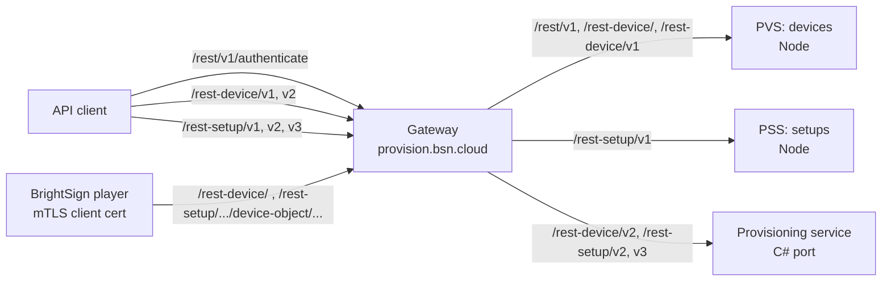
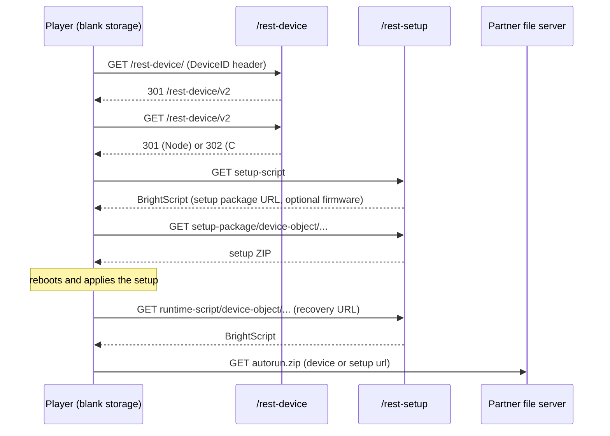

# B-Deploy v1 → v2/v3 migration guide

How to move a client of BrightSign's B-Deploy provisioning API from v1 to the current
v2/v3 API. B-Deploy is the cloud service that tells a factory-fresh player which setup
to apply and where to fetch its content. The guide includes OpenAPI 3.0 specs for both
API generations.

## Contents

| File | Purpose |
|---|---|
| [`docs/MIGRATION-v1-to-v2.md`](docs/MIGRATION-v1-to-v2.md) | **Start here.** How to port a v1 client: auth, paths, behaviour changes, and a field-by-field setup mapping. |
| [`swagger/bdeploy-v2-v3.yaml`](swagger/bdeploy-v2-v3.yaml) | **Current API.** Device API v2, setup API v2 (schema 2.0.0) and v3 (schema 3.0.0). BSN.cloud OAuth2 authentication. Use this for new work. |
| [`swagger/v1Documentation.yaml`](swagger/v1Documentation.yaml) | Legacy v1 API: B-Deploy-local login, PascalCase setup model. Only for maintaining or migrating old clients. |
| [`docs/IMPLEMENTATION-NOTES.md`](docs/IMPLEMENTATION-NOTES.md) | Where the specs come from, known server defects, Node vs C# differences, gopurple mismatches, security findings. |
| [`skills/migrating-bdeploy-v1-to-v2/SKILL.md`](skills/migrating-bdeploy-v1-to-v2/SKILL.md) | Claude Code skill that applies the migration rules to client code. |

## Status and trust level

The specs were written in October 2026 by reading the server source, not by
generating them or by observing live traffic:

- **Node services** (`bsn-core/provisioning-server`): PVS (devices) and PSS (setups).
  The specs use these as the reference behaviour.
- **C# port** (`bsn-cloud-inherited`, `develop`, `BSN.Cloud.Hosts.API.Provisioning`).
  Where it differs in ways a client would notice, the spec says so.
- **`gopurple` SDK**, used as a cross-check.

They have **not** been validated against a running server. These parts are inferred
rather than observed:

- Whether production already runs the C# port for v2/v3. Its gateway route on
  `develop` claims all v2/v3 paths in every environment, but the production deploy is a
  manual step.
- A few C# framework behaviours: empty 401/403 bodies, `application/problem+json`
  errors, and 406 on failed package downloads.

[`docs/IMPLEMENTATION-NOTES.md`](docs/IMPLEMENTATION-NOTES.md) lists every source file used.

Last verified on 2026-10-26 against `provisioning-server` `a7811d7`,
`bsn-cloud-inherited` `develop` `12324a084` and `gopurple` `4bc27aa`.

## How the API is laid out

One host, `https://provision.bsn.cloud`, serves everything. The gateway routes on the
path prefix and strips it before forwarding. v1 stays on the Node services; the C# port's
route (on `develop`) takes all v2/v3 paths.



The resources:

- **Setup**: a reusable player configuration. It covers networking, logging, DWS/LWS,
  firmware policy, and either a BSN.cloud registration token or a partner content URL.
  Setups are identified by `bDeploy.packageName`, which is unique per network.
- **Device**: a player serial number registered in a network and linked to a setup
  (`setupId`) or directly to a partner content URL (`url`).

How a registered player gets provisioned:



The player-side endpoints are in the specs under the **Player protocol** tag. API clients
cannot call them, because they require the player's client certificate.

## Quick start (v2/v3)

1. **Get a token.** Use BSN.cloud OAuth2 client credentials:

   ```bash
   TOKEN=$(curl -s https://auth.bsn.cloud/realms/bsncloud/protocol/openid-connect/token \
     -u "$CLIENT_ID:$CLIENT_SECRET" -d grant_type=client_credentials | jq -r .access_token)
   ```

2. **Select the network.** B-Deploy takes the network from the token's session, not
   from the request:

   ```bash
   curl -s -X PUT https://api.bsn.cloud/2022/06/REST/Self/Session/Network \
     -H "Authorization: Bearer $TOKEN" -H 'Content-Type: application/json' \
     -d '{"name":"mynetwork"}'
   ```

3. **Create a setup.** It returns `{"error":null,"result":"<setupId>"}`:

   ```bash
   curl -s -X POST https://provision.bsn.cloud/rest-setup/v3/setup \
     -H "Authorization: Bearer $TOKEN" -H 'Content-Type: application/json' \
     -d '{
       "version": "3.0.0",
       "setupType": "partnerApplication",
       "bDeploy": {
         "username": "user@example.com",
         "networkName": "mynetwork",
         "packageName": "Lobby setup",
         "url": "https://cms.example.com/bdeploy/autorun.zip"
       },
       "bsnGroupName": "Default"
     }'
   ```

4. **Register a player.** It returns `{"error":null,"result":"<deviceId>"}`:

   ```bash
   curl -s -X POST https://provision.bsn.cloud/rest-device/v2/device \
     -H "Authorization: Bearer $TOKEN" -H 'Content-Type: application/json' \
     -d '{"serial":"UTD416000978","username":"user@example.com",
          "NetworkName":"mynetwork","name":"Lobby","setupId":"<setupId>"}'
   ```

## Things that surprise people

Read these before writing a client. The specs and `IMPLEMENTATION-NOTES.md` have the
detail.

- **Response envelope.** Every JSON response is `{"error": ..., "result": ...}`, and
  creates return 201.
- **Two shapes for setup GETs.**
  - A list returns stored records, with the setup as a JSON *string* in `setupJson`.
  - Get-by-id (`/setup/{id}`) returns a *one-element array* of the parsed setup.
    Don't use `?_id=`: the C# service ignores it and returns the list.
- **`setupId` is never returned by device GETs.** Use `setupName`.
- **Send complete records on PUT.**
  - Device PUT on Node replaces the record, so a partial body deletes fields.
  - Setup PUT on Node applies no defaults, so omitted fields are lost.
  - Setup PUT returns an update result, not the setup.
- **No path ids on writes.** Ids go in the body (`PUT`) or in `?_id=` (`DELETE`).
  There is no `PUT .../{id}`.
- **Filters.** Setup lists filter with `query[packageName]=`; a flat `packageName=` is
  ignored. A device GET with no filter returns an empty list; always pass `NetworkName`.
- **Two server implementations differ** on page-size defaults, id format (24-hex vs
  decimal) and several error codes. Treat ids as opaque, send `pageSize`, and branch on
  status class and the `error` field.

## Viewing the specs

- **Online:** paste or upload a YAML file at <https://editor.swagger.io/>.
- **Locally:** run
  `npx @redocly/cli@1.34.3 preview-docs swagger/bdeploy-v2-v3.yaml`
  (long-running; stop with Ctrl-C).
- **Client code:** both files are self-contained and work with OpenAPI 3.0 code
  generators. The `oneOf` result types and the `JsonNull` schema are deliberate: they
  describe responses whose shape depends on the request.

## Validating and building

Lint both specs with Redocly (requires Node.js for `npx`), from the repository root:

```bash
npx @redocly/cli@1.34.3 lint --extends recommended \
  --skip-rule no-path-trailing-slash --skip-rule info-license \
  swagger/bdeploy-v2-v3.yaml swagger/v1Documentation.yaml
```

Two rules are turned off on purpose:

- `no-path-trailing-slash`: the player entry point really is `/rest-device/`.
- `info-license`: the APIs are proprietary, so there is no license to declare.

The one remaining warning is on `DELETE /rest-device/v1/device/ids/{idarray}`, which is
documented as broken and has no success response.

## Migrating v1 clients

Read [`docs/MIGRATION-v1-to-v2.md`](docs/MIGRATION-v1-to-v2.md). To have Claude Code
apply the same rules to client code, copy `skills/migrating-bdeploy-v1-to-v2/` into the
client project's `.claude/skills/` (or `~/.claude/skills/` for all projects).

## Keeping the specs accurate

The server code is the source of truth. When PVS, PSS or the C# provisioning service
changes:

1. Update the affected operation in the spec.
2. Update the Node vs C# table in `docs/IMPLEMENTATION-NOTES.md` if the two diverge further.
3. Update `docs/MIGRATION-v1-to-v2.md` and the skill if client-visible behaviour changed.
4. Run the lint command above.

Note the source revision you checked against in the commit message.
