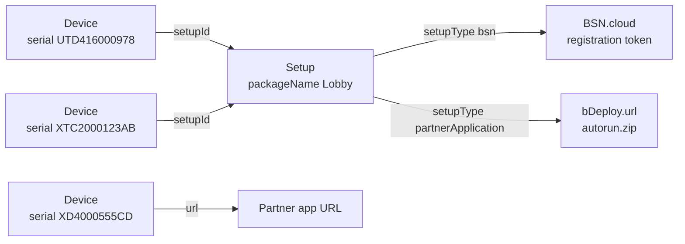
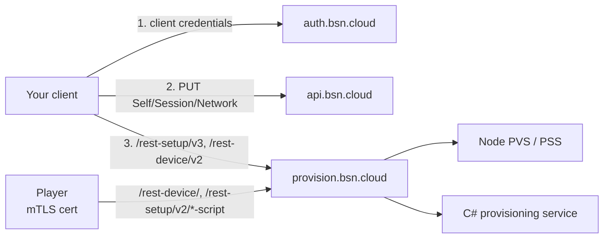
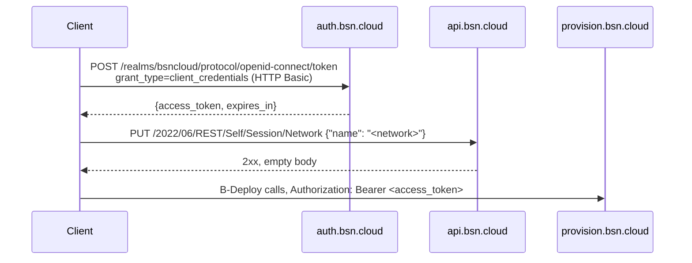

# B-Deploy API guide

A practical guide to BrightSign's B-Deploy provisioning API (device API v2, setup API
v3). It covers what the API is for, how to authenticate, every call a client needs, the
setup fields, and the behaviour that trips people up.

Everything here was checked against the server source (Node PVS/PSS in
`bsn-core/provisioning-server`, the C# port on `bsn-cloud-inherited` `develop`). Where
the two server implementations differ, this guide tells you how to write code that works
on both. The full contract is in [`../swagger/bdeploy-v2-v3.yaml`](../swagger/bdeploy-v2-v3.yaml);
server defects and differences are in [`IMPLEMENTATION-NOTES.md`](IMPLEMENTATION-NOTES.md).
The other BSN.cloud calls a client needs (token, session network, registration tokens)
are in [`../swagger/bsn-main-provisioning.yaml`](../swagger/bsn-main-provisioning.yaml).

Migrating from the v1 API? Read [`MIGRATION-v1-to-v2.md`](MIGRATION-v1-to-v2.md) first.

## Contents

1. [What B-Deploy does](#1-what-b-deploy-does)
2. [Hosts and services](#2-hosts-and-services)
3. [Authentication and network context](#3-authentication-and-network-context)
4. [Prerequisites and live check](#4-prerequisites-and-live-check)
5. [Conventions for every call](#5-conventions-for-every-call)
6. [Setups](#6-setups)
7. [Setup field reference](#7-setup-field-reference)
8. [Devices](#8-devices)
9. [Linking players to setups](#9-linking-players-to-setups)
10. [Registration tokens](#10-registration-tokens)
11. [What the player does](#11-what-the-player-does)
12. [Common workflows](#12-common-workflows)
13. [Troubleshooting](#13-troubleshooting)
14. [Pitfalls checklist](#14-pitfalls-checklist)
15. [Notes on the gopurple B-Deploy docs](#15-notes-on-the-gopurple-b-deploy-docs)

## 1. What B-Deploy does

A factory-fresh BrightSign player with blank storage asks B-Deploy, "what should I be?"
B-Deploy answers with a **setup**: networking, logging, diagnostics, firmware policy, and
either a BSN.cloud registration token or the URL of a partner application. The player
applies the setup, reboots, and from then on runs that configuration.

Two resources:

| Resource | What it is | Key | Path |
|---|---|---|---|
| **Setup** | A reusable player configuration | `bDeploy.packageName`, unique per network | `/rest-setup/v3/setup` |
| **Device** | One player serial number, registered in a network and linked to a setup or a URL | `serial`, globally unique | `/rest-device/v2/device` |



One setup serves many players. A device without a setup can still point straight at a
partner application with `url`.

**Setup types** (`setupType`) decide what the player does after setup:

| `setupType` | Player behaviour | Extra requirements |
|---|---|---|
| `bsn` | Registers with BSN.cloud and is managed from there | `bsnDeviceRegistrationTokenEntity` ([section 10](#10-registration-tokens)) |
| `partnerApplication` | Downloads and runs a partner application | `bDeploy.url` on the setup, or `url` on each device |
| `sfn` | Simple File Networking: pulls content from a web folder | `sfnWebFolderUrl` (+ `sfnUserName`/`sfnPassword` if basic auth) |
| `lfn` | Local File Networking: content is published to the player over the LAN | — |
| `standalone` | Runs local content with no content network | — |

Avoid `legacyLfn` and `localToBsn`. Node accepts them, but the C# service rejects them.

## 2. Hosts and services

| Purpose | Host |
|---|---|
| OAuth2 tokens | `https://auth.bsn.cloud` |
| BSN.cloud Main API (session network, registration tokens) | `https://api.bsn.cloud` |
| B-Deploy | `https://provision.bsn.cloud` |

Non-production B-Deploy hosts: `provision.bsn-staging.net`, `provision.bsn-qa.net`,
`provision.bsn-dev.net`.

Behind `provision.bsn.cloud`, a gateway routes on path prefix and strips it. There are
two implementations of the v2/v3 API: the original Node services (PVS for devices, PSS
for setups) and a C# port. **Production v2/v3 is served by the C# port** (observed
2026-10-26: responses come from Kestrel); v1 stays on Node. Other environments may lag,
so still write clients that work against both. Section 5 lists what that takes.



## 3. Authentication and network context

The calls in this section and in [section 10](#10-registration-tokens) are specified in
[`../swagger/bsn-main-provisioning.yaml`](../swagger/bsn-main-provisioning.yaml).

B-Deploy v2/v3 uses BSN.cloud OAuth2 access tokens. The network your calls act on is
**not** a request parameter: it comes from the token's BSN.cloud session, which you set
with a separate call.



```bash
TOKEN=$(curl -s https://auth.bsn.cloud/realms/bsncloud/protocol/openid-connect/token \
  -u "$BS_CLIENT_ID:$BS_SECRET" -d grant_type=client_credentials | jq -r .access_token)

curl -s -X PUT https://api.bsn.cloud/2022/06/REST/Self/Session/Network \
  -H "Authorization: Bearer $TOKEN" -H 'Accept: application/json' -H 'Content-Type: application/json' \
  -d "{\"name\":\"$BS_NETWORK\"}"
```

Rules:

- **Send `Accept: application/json` on every request.** Without it the Main API returns
  `300 Multiple Choices` with an empty body and does nothing, so the session network is
  never set and every B-Deploy call then fails with an empty-body 403. Treat any non-2xx
  as a failure, including 3xx.
- **Send a User-Agent of your own.** Cloudflare in front of `auth.bsn.cloud` and
  `api.bsn.cloud` blocks some default library agents (Python's `Python-urllib` gets 403
  `error code: 1010`).
- **Set the session network after every new token.** The network belongs to the token's
  session, so a refreshed token needs the PUT again.
- **Without a session network** calls fail: Node returns 401
  (`"Unauthorized"` on devices, `"Error: Invalid token"` on setups); C# returns 403
  `"Token does not include a network"`, or 200 with `{"error":"Error: Invalid user"}` on
  some device routes. Always check the `error` field, not only the status.
- You also need the BSN.cloud **username** (the account e-mail). Setups carry it in
  `bDeploy.username` and devices in `username`.

## 4. Prerequisites and live check

The specs and this guide were derived from source. Before writing client code, confirm
that your credentials, network and environment actually work. The check below takes a
minute and catches every failure we hit on first contact with production.

### What you need

| Item | Notes |
|---|---|
| API client id and secret | An OAuth2 client created in BSN.cloud. B-Deploy acts as the client's **owner**, so the owning account must be a user in the target network. |
| Network name | Exactly as BSN.cloud shows it (case and spaces matter). |
| Account e-mail | Only needed to create setups and devices (`bDeploy.username`, `username`). |
| Scope `bsn.api.main.devices.setups.token.create` | Only needed to create registration tokens (`bsn` setups). |
| Production hosts | `auth.bsn.cloud`, `api.bsn.cloud`, `provision.bsn.cloud`. Credentials from another environment fail with `invalid_client`. |

### Run the check

These commands change nothing. They get a token, select the network, **read the session
network back** to prove the selection took effect, and list setups and devices. If a step
fails, look the response up in [Troubleshooting](#13-troubleshooting). When you write a
client, make its first test do the same four steps.

```bash
export BS_CLIENT_ID=<client id>  BS_SECRET=<secret>  BS_NETWORK=<network name>

TOKEN=$(curl -s https://auth.bsn.cloud/realms/bsncloud/protocol/openid-connect/token \
  -u "$BS_CLIENT_ID:$BS_SECRET" -d grant_type=client_credentials | jq -r .access_token)

# 1. Select the network: expect 204
curl -s -o /dev/null -w '%{http_code}\n' -X PUT \
  https://api.bsn.cloud/2022/06/REST/Self/Session/Network \
  -H "Authorization: Bearer $TOKEN" -H 'Accept: application/json' \
  -H 'Content-Type: application/json' -d "{\"name\":\"$BS_NETWORK\"}"

# 2. Read it back: expect 200 {"id":...,"name":"<network>"}
curl -s https://api.bsn.cloud/2022/06/REST/Self/Session/Network \
  -H "Authorization: Bearer $TOKEN" -H 'Accept: application/json'

# 3. List setups: expect {"error":null,"result":[...]}; note the server header
curl -s -D - "https://provision.bsn.cloud/rest-setup/v3/setup?NetworkName=$BS_NETWORK&pageSize=5" \
  -H "Authorization: Bearer $TOKEN" -H 'Accept: application/json' | grep -i -E '^server:|^\{'

# 4. List devices: expect {"error":null,"result":{"total":...,"players":[...]}}
curl -s "https://provision.bsn.cloud/rest-device/v2/device?NetworkName=$BS_NETWORK&pageSize=5" \
  -H "Authorization: Bearer $TOKEN" -H 'Accept: application/json'
```

URL-encode the network name in steps 3 and 4 if it contains spaces or other reserved
characters.

What to look for:

- Step 1 must be **204**. A 300 means the `Accept` header is missing; a 400 means the
  account is not a member of that network or the name is wrong.
- Step 2 must return 200 with your network. A 204 with no body means no network is
  selected, and every B-Deploy call will fail.
- Step 3's `server` header tells you which implementation you are talking to:
  `Kestrel` is the C# service (production v2/v3 as of 2026-10-26); otherwise assume
  Node. Code against the C# column of the differences table when it says Kestrel.

Access tokens are short-lived (about 5.5 minutes, with no refresh token) and sessions
end after 24 hours. Fetch a new token before expiry and select the network again each
time.

## 5. Conventions for every call

**Envelope.** Every JSON response is:

```json
{"error": null, "result": "..."}
```

`error` is a string (or `null` on success). Creates return **201**. Treat a non-null
`error` as a failure even on a 2xx: the C# service returns some errors with 200.

**Status codes.** The implementations disagree on several 4xx codes (400 vs 403 vs
404), and some client mistakes produce 500. Branch on status class and on `error`, not
on exact 4xx values. The C# service can return 401/403 with an **empty** body and
framework errors as `application/problem+json`; tolerate both.

**Content-Type.** Send exactly `Content-Type: application/json` on POST/PUT. Node's setup
service rejects `application/json; charset=utf-8` with 415.

**Ids.** Opaque strings. Node creates 24-hex MongoDB ObjectIds; C# creates decimal
strings such as `"1234"`. Node rejects a decimal id with 400 "Invalid Device ID", which is
one more reason the two should not be mixed on one dataset.

**No path ids on writes.** Updates put the id in the body; deletes use `?_id=`. There is
no `PUT .../{id}` and no `DELETE .../{id}`.

**Paging.** `pageNum` (1-based) and `pageSize` (1–100). Defaults differ (Node 100, C#
50), so always send `pageSize`. Keep reading pages until one comes back shorter than
`pageSize`.

**Filters.** Lists take flat parameters for a few fields (`NetworkName`, `username`,
`serial`, `pageNum`, `pageSize`) and bracketed `qs`-style objects for everything else:
`query[packageName]=Lobby`, `sort[packageName]=1`. A flat parameter that is not
supported is **silently ignored**: `?packageName=Lobby` returns every setup.

**Serials.** Stored upper-case and matched case-sensitively. Upper-case them before
sending.

**Expired tokens.** Refresh before `expires_in` runs out. If a call still gets a 401, get
a new token, select the network again, and retry that call **once**; a second 401 is a
real failure. Don't apply this to 403: on the C# service an empty-body 403 usually means
the session has no network, which a retry without re-selecting will not fix.

**Rate limits.** BSN.cloud can return 429. Quotas are not published; back off and retry
later, honouring `Retry-After` if present.

**Retries.** Never retry POST or PUT automatically (they are not idempotent), and never
retry the deterministic 500s (setup "in use", Node's missing-`username` crash).

## 6. Setups

All setup calls use `/rest-setup/v3/setup` (schema `3.0.0`). The `/rest-setup/v2` routes
are the same with schema `2.0.0`; use v3 for new work.

| Operation | Request | `result` |
|---|---|---|
| Create | `POST /rest-setup/v3/setup` | new id (string) |
| List | `GET /rest-setup/v3/setup?NetworkName=<net>&pageSize=100[&query[packageName]=…]` | array of **records**; the setup is a JSON **string** in `setupJson` |
| Get one | `GET /rest-setup/v3/setup/{id}` | **one-element array** holding the parsed setup |
| Update | `PUT /rest-setup/v3/setup`, `_id` in the body, complete setup | update result (`{acknowledged, matchedCount, modifiedCount, …}`), **not** the setup |
| Delete | `DELETE /rest-setup/v3/setup?_id=<id>` | `true` |

### Create

The minimum is `version`, `setupType`, `bDeploy` (`username`, `networkName`,
`packageName`), and anything the setup type requires. `bsnGroupName` defaults to
`"Default"`. On POST the server merges its defaults into every omitted top-level field
([section 7](#7-setup-field-reference)).

Partner application:

```json
{
  "version": "3.0.0",
  "setupType": "partnerApplication",
  "bDeploy": {
    "username": "user@example.com",
    "networkName": "mynetwork",
    "packageName": "Lobby",
    "url": "https://cms.example.com/bdeploy/autorun.zip"
  },
  "bsnGroupName": "Default",
  "lwsEnabled": false
}
```

BSN.cloud-managed (needs a registration token, [section 10](#10-registration-tokens)):

```json
{
  "version": "3.0.0",
  "setupType": "bsn",
  "bDeploy": {"username": "user@example.com", "networkName": "mynetwork", "packageName": "Store 12"},
  "bsnGroupName": "Stores",
  "bsnDeviceRegistrationTokenEntity": {
    "token": "<token>", "scope": "cert",
    "validFrom": "2026-10-26T00:00:00Z", "validTo": "2028-10-26T00:00:00Z"
  }
}
```

Simple File Networking:

```json
{
  "version": "3.0.0",
  "setupType": "sfn",
  "bDeploy": {"username": "user@example.com", "networkName": "mynetwork", "packageName": "Menu boards"},
  "bsnGroupName": "Default",
  "sfnWebFolderUrl": "https://content.example.com/menus/",
  "sfnEnableBasicAuthentication": true,
  "sfnUserName": "player",
  "sfnPassword": "secret"
}
```

Create rules:

- `bDeploy.packageName` must be unique within the network. Existing data does not always
  honour this (duplicates exist in live networks), so name look-ups must handle more than
  one match.
- `bDeploy.url`, if present, must be an absolute URL.
- `bsnGroupName` must not start or end with whitespace or a period.
- A v3 setup must have a `network` object (the POST default supplies one).
- The C# service also demands a registration token when `bDeploy.username` contains
  `brightsign`, `bsn` or `bacon` (case-insensitive), whatever the setup type.
- Posting an array creates several setups and returns an array of ids. A one-element
  array returns a bare id.

### List

```http
GET /rest-setup/v3/setup?NetworkName=mynetwork&pageSize=100&query[packageName]=Lobby
```

```json
{"error": null, "result": [
  {"_id": "6917e8cf04cd25f13c883f51", "packageName": "Lobby", "setupType": "partnerApplication",
   "networkName": "mynetwork", "username": "user@example.com", "bsnGroupName": "Default",
   "version": "3.0.0", "setupJson": "{\"version\":\"3.0.0\",\"bDeploy\":{...}}",
   "createdAt": "2026-10-20T09:00:00.000Z", "updatedAt": "2026-10-20T09:00:00.000Z"}
]}
```

- Always name the network. Node returns 400 without it.
- `setupJson` is a **string**: parse it to get the setup.
- Filter with `query[packageName]`, `query[setupType]`, `query[username]`,
  `query[bsnGroupName]`, `query[deviceName]`, `query[deviceDescription]`. Node matches
  exactly; C# matches "contains", case-sensitive. To find one setup by name, filter and
  then compare `packageName` exactly on the client.
- Don't rely on the record's top-level `version` to describe `setupJson`; the two can
  disagree.

### Get one

```http
GET /rest-setup/v3/setup/6917e8cf04cd25f13c883f51
```

```json
{"error": null, "result": [{"version": "3.0.0", "_id": "6917e8cf04cd25f13c883f51", "bDeploy": {...}, ...}]}
```

The result is an array: take element 0. Use the path form. `GET /setup?_id=…` works on
Node but the C# service ignores `_id` and returns the whole list.

### Update

PUT replaces the stored setup with what you send. Node applies **no** defaults on PUT
(C# does), so a partial body erases every field you leave out. Always:

1. GET the setup (`/setup/{id}`, element 0).
2. Change the fields you need.
3. PUT the whole object, with `_id` in the body.
4. GET again if you need the stored result; PUT returns an update result.

```http
PUT /rest-setup/v3/setup
Content-Type: application/json

{"_id": "6917e8cf04cd25f13c883f51", "version": "3.0.0", "bDeploy": {...}, "setupType": "partnerApplication", ...}
```

### Delete

```http
DELETE /rest-setup/v3/setup?_id=6917e8cf04cd25f13c883f51
```

Deleting a setup that a device still references fails with **500** "Cannot delete
device setup because it is in use". Delete or relink those devices first. Don't retry
this 500: it is deterministic.

## 7. Setup field reference

Defaults are what a POST fills in for an omitted top-level field (from
`deviceSetupDefault.ts`, matching the C# `BsDsSetupParams`). **Several defaults turn
features on**, notably `lwsEnabled`, `remoteDwsEnabled`, `bsnCloudEnabled` and
`inheritNetworkProperties`. Send `false` for anything you want off.

**Older setups may not be typed like this.** Setups created by older tools have been
seen with booleans stored as `"1"`/`""`, numbers as strings (`"69"`), `network.dns` as
`""` and interface `security` as `[]` (live captures in `bsn-cloud-openapi`,
`examples/bdeploy/live-provision-list.json`). Newer setups use the types below. When
reading `setupJson`, accept both; when writing, always send the canonical types.

### Identity and type

| Field | Type | Default | Notes |
|---|---|---|---|
| `version` | string | `"3.0.0"` | Must be `3.x` on `/v3`, `2.x` on `/v2` |
| `setupType` | string | `"standalone"` | See [section 1](#1-what-b-deploy-does) |
| `bDeploy.username` | string | — | Required. BSN.cloud account e-mail |
| `bDeploy.networkName` | string | — | Required on Node. C# fills it from the token |
| `bDeploy.packageName` | string | — | Required; unique per network |
| `bDeploy.client` | string | token client id (Node), `"default-client"` (C#) | |
| `bDeploy.url` | string | — | Partner application URL (`partnerApplication`) |
| `bsnGroupName` | string | `"Default"` | BSN.cloud group the player joins (`bsn`) |
| `bsnDeviceRegistrationTokenEntity` | object | `null` | `{token, scope, validFrom, validTo}`; required for `bsn` |
| `deviceName` | string | `""` | A device's `name` overrides it |
| `deviceDescription` | string | `""` | A device's `desc` overrides it |
| `unitNamingMethod` | string | `"appendUnitIDToUnitName"` | or `"unitNameOnly"` |
| `timeZone` | string | `"PST"` | BrightSign time-zone code, not an IANA name |

### Remote access and diagnostics

| Field | Type | Default | Notes |
|---|---|---|---|
| `remoteDwsEnabled` | bool | **`true`** | Remote Diagnostic Web Server via BSN.cloud |
| `dwsEnabled` | bool | `false` | Local DWS |
| `dwsPassword` | string | `""` | |
| `lwsEnabled` | bool | **`true`** | Local Web Server |
| `lwsConfig` | string | `"status"` | `"status"`, `"content"` or `"none"` |
| `lwsUserName` / `lwsPassword` | string | `""` | |
| `lwsEnableUpdateNotifications` | bool | `true` | |
| `bsnCloudEnabled` | bool | **`true`** | |
| `enableSerialDebugging` | bool | `false` | |
| `enableSystemLogDebugging` | bool | `false` | |
| `networkDiagnosticsEnabled` | bool | `false` | |
| `testEthernetEnabled` / `testWirelessEnabled` / `testInternetEnabled` | bool | `false` | |

### Content, logging and snapshots

| Field | Type | Default | Notes |
|---|---|---|---|
| `timeBetweenNetConnects` | int | `300` | Seconds between content checks |
| `contentDownloadsRestricted` | bool | `false` | |
| `contentDownloadRangeStart` / `contentDownloadRangeEnd` | int | `0` | Minutes |
| `sfnWebFolderUrl`, `sfnUserName`, `sfnPassword` | string | `""` | `sfn` only |
| `sfnEnableBasicAuthentication` | bool | `false` | |
| `playbackLoggingEnabled`, `eventLoggingEnabled`, `diagnosticLoggingEnabled`, `stateLoggingEnabled`, `variableLoggingEnabled` | bool | `false` | |
| `uploadLogFilesAtBoot` | bool | `false` | |
| `uploadLogFilesAtSpecificTime` / `uploadLogFilesTime` | bool / int | `false` / `0` | |
| `logHandlerUrl` | string | `""` | |
| `enableRemoteSnapshot` | bool | `false` | |
| `remoteSnapshotInterval` | int | `15` | |
| `remoteSnapshotMaxImages` | int | `5` | |
| `remoteSnapshotJpegQualityLevel` | int | `100` | |
| `remoteSnapshotScreenOrientation` | string | `"Landscape"` | `Landscape`, `PortraitBottomLeft`, `PortraitBottomRight` |
| `remoteSnapshotHandlerUrl` | string | `""` | |
| `idleScreenColor` | object | `{r:0,g:0,b:0,a:1}` | |
| `useCustomSplashScreen` | bool | `false` | |
| `BrightWallName` / `BrightWallScreenNumber` | string | `""` | |
| `usbUpdatePassword` | string | `""` | |

### Firmware

| Field | Type | Default | Notes |
|---|---|---|---|
| `firmwareUpdateType` | string | `"standard"` | `standard`, `different`, `newer`, `save` |
| `firmwareUpdatesByFamily` | object | one entry per family | Keyed by family name (`Impala`, `Pantera`, `Tiger`, `Pagani`, `Malibu`, `Sebring`, `Raptor`, `Cobra`, `Camaro`, `Thor`, …) |

Each family entry describes the firmware source and target (`firmwareUpdateSource`,
`firmwareUpdateSourceUrl`, `firmwareUpdateVersion`, production/beta/compatible release
URLs, versions and SHA1s). Leave these as the server generates them unless you are
deliberately pinning firmware: copy them from an existing setup rather than writing them
by hand.

### Network (`network`, schema 3.0.0)

| Field | Type | Default | Notes |
|---|---|---|---|
| `inheritNetworkProperties` | bool | **`true`** | |
| `network.timeServers` | string[] | `["http://time.brightsignnetwork.com"]` | |
| `network.hostname` | string | `null` | |
| `network.proxyServer` | string | `null` | Not `proxy` |
| `network.proxyBypass` | string[] | `null` | An array, not a string |
| `network.interfaces` | object[] | one wired DHCP interface | See below |

Interface entries:

| Field | Ethernet | WiFi | Notes |
|---|---|---|---|
| `id`, `name` | `wired_eth0`, `eth0` | `wireless_wlan0`, `wlan0` | |
| `type` | `"Ethernet"` | `"WiFi"` | also `Virtual` (VLAN), `Cellular` |
| `proto` | `"DHCPv4"` | `"DHCPv4"` | `"Static"` needs `ip`, `gateway`, `dns` |
| `ip` | `[]` | `[]` | CIDR strings, e.g. `"192.168.1.50/24"` |
| `gateway` | `null` | `null` | |
| `dns` | `[]` | `[]` | |
| `metric` | `null` | `null` | Connection priority |
| `ssid`, `passphrase` | — | `""` | |
| `security` | — | `{authentication:{mode,passphrase}, encryption:{mode}}` | |
| `rateLimitDuringInitialDownloads`, `rateLimitInsideContentDownloadWindow`, `rateLimitOutsideContentDownloadWindow` | `null` | `null` | |
| `contentDownloadEnabled`, `textFeedsDownloadEnabled`, `mediaFeedsDownloadEnabled`, `healthReportingEnabled`, `logsUploadEnabled` | `true` | `true` | |
| `wpaSettings` | WPA-Enterprise off | WPA-Enterprise off | |

The servers do not validate static addressing. A `Static` interface without addresses is
accepted and only fails on the player.

## 8. Devices

All device calls use `/rest-device/v2/device`. There is no device v3.

| Operation | Request | `result` |
|---|---|---|
| Register | `POST /rest-device/v2/device` | new id (string) |
| Find | `GET /rest-device/v2/device?serial=<s>&NetworkName=<net>` | `{total, matched, players[], priv}` |
| List | `GET /rest-device/v2/device?NetworkName=<net>&pageSize=100&pageNum=<n>` | `{total, matched, players[], priv}` |
| Get by id | `GET /rest-device/v2/device?_id=<id>` | the device object, or `null` |
| Update | `PUT /rest-device/v2/device`, `_id` **and** `serial` in body, complete record | `null` |
| Delete | `DELETE /rest-device/v2/device?_id=<id>` or `?serial=<s>` | `true` |
| Bulk delete | `DELETE /rest-device/v2/device/ids/["id1","id2"]` | `{deletedCount, deletedIds, failedIds, message}` |

### Register

```json
{
  "serial": "UTD416000978",
  "username": "user@example.com",
  "NetworkName": "mynetwork",
  "name": "Lobby left",
  "desc": "Ground floor",
  "setupId": "6917e8cf04cd25f13c883f51"
}
```

- Required: `serial`, `username`, and in practice `NetworkName` plus either `setupId`
  or `url` (the C# service requires them for a new record).
- `serial` is unique **across all networks**. If the serial is registered anywhere you
  get 400 "Player already exists". POST never updates an existing device; use PUT.
- C# also checks that `serial` is 12 characters and that `NetworkName` equals the
  token's network (403 otherwise). It takes `username`, `client` and `NetworkName` from
  the token rather than the body.
- When `setupId` is given, the server stores the setup's package name as `setupName`.

### Find and list

```json
{"error": null, "result": {"total": 1, "matched": 1, "priv": false, "players": [
  {"_id": "689fcb2d03af0e3de789c742", "serial": "UTD416000978", "NetworkName": "mynetwork",
   "username": "user@example.com", "name": "Lobby left", "setupName": "Lobby",
   "createdAt": "2026-10-20T09:05:00.000Z", "updatedAt": "2026-10-20T09:05:00.000Z"}
]}}
```

- **A GET with no filter returns an empty list.** Always pass `NetworkName` (and
  `serial` to find one player).
- **`setupId` is never returned.** Both implementations strip it. Use `setupName`.
- `total` is not a usable count. Page until a page is shorter than `pageSize`.
- Filters: flat `serial`, `NetworkName`, `username` (prefix, case-insensitive on Node;
  contains on C#); `query[setupName]`, `query[model]`, `query[setupId]` for the rest.

### Update

Node **replaces** the stored record with the body; C# merges the keys you send. To be
safe on both, always send the complete record:

1. Find the device (it comes back without `setupId`).
2. Change the fields you need.
3. Put `setupId` back if the device should stay linked (see below).
4. PUT the whole record, including `_id` and `serial`.

```json
{
  "_id": "689fcb2d03af0e3de789c742",
  "serial": "UTD416000978",
  "username": "user@example.com",
  "NetworkName": "mynetwork",
  "name": "Lobby left (renamed)",
  "setupId": "6917e8cf04cd25f13c883f51"
}
```

Fields you leave out are deleted on Node, and `createdAt` resets unless you send it
back. Make sure `_id` and `serial` belong to the same device: on Node a mismatch deletes
the `_id` record (see `IMPLEMENTATION-NOTES.md`). PUT returns `null`; GET again for the
stored record.

### Delete

`DELETE /rest-device/v2/device?_id=<id>` or `?serial=<SERIAL>`. Bulk delete takes a JSON
array of id strings in the path (URL-encode it); always 200 once the array is valid, so
read `failedIds`. On Node an empty or malformed array produces a non-JSON 500.

## 9. Linking players to setups

The link is the device's `setupId`, not BSN.cloud groups. `bsnGroupName` on a setup only
decides which BSN.cloud group a `bsn` player joins after provisioning.

| Want | Do |
|---|---|
| Link a new player | `POST /device` with `setupId` |
| Move a player to another setup | Full-record `PUT /device` with the new `setupId` |
| See which setup a player uses | Read `setupName` from `GET /device?serial=…&NetworkName=…` |
| Keep the link when editing a device | Re-add `setupId` before the PUT |
| Send one player to a different app | Set `url` on the device (overrides the setup's `bDeploy.url`) |
| Pass per-player data to the app | `userdata` (≤ 1024 chars), sent by the player as the `UserData` header when it fetches `url` |
| Override name or description | `name` / `desc` on the device override the setup's `deviceName` / `deviceDescription` |

If you PUT a device without `setupId`, Node tries to recover it from `setupName` plus
`NetworkName`, but only when exactly one setup matches. Don't depend on it: track the
setup id on your side or look it up by `packageName` before the PUT.

## 10. Registration tokens

A `bsn` setup must carry a BSN.cloud device registration token. Create one with the
Main API, using the same access token and session network:

```bash
curl -s -X POST https://api.bsn.cloud/2022/06/REST/Provisioning/Setups/Tokens/ \
  -H "Authorization: Bearer $TOKEN" -H 'Accept: application/json'
```

```json
{"token": "<token>", "scope": "cert", "validFrom": "2026-10-26T00:00:00Z", "validTo": "2028-10-26T00:00:00Z"}
```

Copy all four fields into `bsnDeviceRegistrationTokenEntity`. The token has `cert`
scope, is shared by every player provisioned from the setup, and is valid for two years
by default. Scopes needed: `bsn.api.main.devices.setups.token.create` (create),
`…token.validate` (`GET …/Tokens/{token}/`) and `…token.revoke` (`DELETE …/Tokens/{token}/`).
Revoking a token stops every player that has not yet registered with it.

## 11. What the player does

You don't call these endpoints (they need the player's client certificate), but knowing
the flow helps when debugging.

```mermaid
sequenceDiagram
    participant P as Player (blank storage)
    participant D as /rest-device
    participant S as /rest-setup
    participant F as Partner file server
    P->>D: GET /rest-device/ (DeviceID header)
    D-->>P: 301 /rest-device/v2 (firmware 8.0.0+; 204 otherwise)
    P->>D: GET /rest-device/v2
    D-->>P: 301 (Node) or 302 (C#) to setup-script
    P->>S: GET /rest-setup/v2/setup-script/device-object/...
    S-->>P: BrightScript (setup package URL, optional firmware)
    P->>S: GET /rest-setup/v2/setup-package/device-object/...
    S-->>P: setup ZIP
    Note over P: reboots and applies the setup
    P->>S: GET /rest-setup/v2/runtime-script/device-object/... (recovery URL)
    S-->>P: BrightScript
    P->>F: GET url (device url, else setup bDeploy.url), UserData header
```

If a player is not provisioning, check in this order: the serial is registered (upper
case) in the right network; the device has a `setupId` or `url`; the setup exists and is
valid for its type; the `url` is reachable from the player's network.

## 12. Common workflows

**Provision a new player with an existing setup**

1. Authenticate and set the session network.
2. Find the setup: list with `query[packageName]=<name>`, match `packageName` exactly,
   take `_id`.
3. `POST /device` with `serial`, `username`, `NetworkName`, `name`, `setupId`.
4. Power the player on with blank storage.

**Create a fleet setup and register many players**

1. (`bsn` only) Create a registration token.
2. `POST /setup`, keep the returned id.
3. `POST /device` once per serial with that `setupId`. Post them one at a time, or
   as an array body only for serials you know are new: array bodies skip the
   "already exists" check and fail with a duplicate-key error instead.

**Change a setup used by many players**

GET the setup, modify, PUT the complete object. Players pick up the change the next time
they provision.

**Move a player to another setup**

Find the device, set `setupId` to the new setup, PUT the complete record. Then
re-provision the player (see below).

**Make a player pick up a change now**

A player reads its setup when it provisions, so changes to its device record or setup
take effect at the next provisioning. To force it, call Remote DWS on the player:
`GET https://ws.bsn.cloud/rest/v1/re-provision/?destinationType=player&destinationName=<SERIAL>`
with the same bearer token (the player must be in the session network and online).
**This clears the player's storage and reboots it.** Alternatively, clear its storage
locally.

**Move a player to another network**

A serial can be registered in only one network. Delete the device record in the old
network (`DELETE /device?serial=` with a token whose session is on that network; only
that network's users can), select the new network, register the serial there with
`POST /device`, then re-provision the player.

**Decommission**

Delete the devices (`DELETE ?serial=`), then delete the setup. The setup delete fails with
500 while any device still references it.

## 13. Troubleshooting

Find the symptom, then check the causes in order. "C#" and "Node" refer to the server
implementation (see the `server` header check in [section 4](#4-prerequisites-and-live-check)).

### Authentication and session

| Symptom | Host | Cause | Fix |
|---|---|---|---|
| 403, body `error code: 1010` | `auth.bsn.cloud`, `api.bsn.cloud` | Cloudflare blocked the client's User-Agent (Python's default `Python-urllib` is blocked) | Send your own `User-Agent` |
| 415 from the token endpoint | `auth.bsn.cloud` | Body not sent as `application/x-www-form-urlencoded` | Send `grant_type=client_credentials` as a form body |
| 401 `{"error":"invalid_client"}` | `auth.bsn.cloud` | Wrong id or secret, client deleted or disabled, or credentials from another environment | Check the client in BSN.cloud; regenerate the secret |
| 300 Multiple Choices, empty body | `api.bsn.cloud` | No `Accept` header. The call did nothing. | Send `Accept: application/json` on every request; treat 3xx as failure |
| 400 on `PUT Self/Session/Network` | `api.bsn.cloud` | The client's owner is not a member of that network, the name is wrong, or the account or network is locked out | Check the network name and membership |
| `GET Self/Session/Network` returns 204 with no body | `api.bsn.cloud` | The network was never selected (often the 300 above, unnoticed) | Fix the PUT; check it returns 204 |
| 410 Gone | `api.bsn.cloud` | Session expired (24-hour ceiling) | Get a new token and select the network again |

### B-Deploy calls

| Symptom | Cause | Fix |
|---|---|---|
| 403, **empty body**, `server: Kestrel` | C# could not place the caller in a network: no session network, or the token's owner is not a user of that network. Setup routes and device lists need a network user. | Run the live check; confirm step 2 returns your network |
| 401 `{"error":"Unauthorized"}` (devices) or `{"error":"Error: Invalid token"}` (setups) | Node: no session network on the token | Select the network after every new token |
| 403 `"Token does not include a network"` | C#: no session network | As above |
| 200 `{"error":"Error: Invalid user","result":null}` | C# device routes: no session network, or a token with no user or client identity. It is a 200, so a status-only check misses it. | Check `error` on every response |
| 401 or 403 after working for a few minutes | Token expired (about 5.5 minutes) | Refresh before `expires_in`, then select the network again; on a 401, re-authenticate and retry once |
| 429 Too Many Requests | Rate limited (quotas are not published) | Back off; honour `Retry-After` if present |
| 415 on setup POST/PUT | Node: `Content-Type` has a parameter such as `; charset=utf-8` | Send exactly `application/json` |
| 400 "Player already exists" | The serial is registered, possibly in another network; POST never updates | Use PUT, or delete the old record first |
| 400 on device POST (C#) | Serial not 12 characters, `setupId`/`url` missing, or `NetworkName` differs from the token's network | Fix the body; errors are joined with `"; "` |
| 400 "Unsupported setup type" | C# rejects `legacyLfn` and `localToBsn` | Use `standalone`, `lfn`, `sfn`, `bsn` or `partnerApplication` |
| 400 saying a registration token is required | `setupType: bsn`, or (C#) a `bDeploy.username` containing `brightsign`, `bsn` or `bacon` | Add `bsnDeviceRegistrationTokenEntity` ([section 10](#10-registration-tokens)) |
| 400 package name not unique | `bDeploy.packageName` already used in the network | Choose another name, or update the existing setup |
| 500 "Cannot delete device setup because it is in use" | Devices still reference the setup | Delete or relink those devices; don't retry |
| 500 with an HTML body (Node) | Setup POST/PUT without `bDeploy.username` | Always send `bDeploy.username` |
| Device list is empty | No filter, a lower-case serial, or `NetworkName` for another network | Pass `NetworkName`; upper-case serials |
| Setup list ignores the name filter | Flat `?packageName=` is silently ignored | Use `query[packageName]=` |
| `GET /setup?_id=…` returns many setups | C# ignores `?_id=` | Use `GET /setup/{id}` |
| Fields vanished after a PUT | Partial body: Node replaces the whole record and applies no setup defaults | GET, modify, PUT the complete record |
| Device no longer linked after a PUT | `setupId` is never returned by GET, so it was missing from the PUT | Re-add `setupId` before every device PUT |
| More than one setup with the same name | Old data does not honour uniqueness | Handle duplicates in name look-ups; use ids |

### Player not provisioning

1. The serial is registered, **upper-case**, in the right network
   (`GET /device?serial=…&NetworkName=…`).
2. The device has a setup (`setupName` is set) or a `url`.
3. The setup exists, has the right `setupType`, and has a registration token if it is `bsn`.
4. The token (if any) is within `validFrom`/`validTo` and not revoked.
5. The partner `url` is reachable from the player's network.
6. The player runs firmware 8.0.0 or later (older firmware gets 204 from the entry point)
   and has blank storage.

## 14. Pitfalls checklist

- [ ] `Accept: application/json` and an explicit User-Agent on every request; 3xx treated as failure.
- [ ] Session network set after every token refresh.
- [ ] `Content-Type: application/json` exactly, on POST and PUT.
- [ ] `error` checked on every response, even 2xx.
- [ ] `pageSize` always sent; paging continues until a short page.
- [ ] Setup lists filtered with `query[...]` and `NetworkName`; `setupJson` parsed from a string.
- [ ] Single setups fetched with `/setup/{id}`; element 0 of the array.
- [ ] Setup and device PUTs send complete records; result re-read with GET.
- [ ] `setupId` re-added before every device PUT that should keep the link.
- [ ] Serials upper-cased.
- [ ] Ids treated as opaque strings.
- [ ] POST defaults that switch features on are set to `false` where needed.
- [ ] On 401: new token, select the network again, retry once. No other automatic retries
      on POST/PUT, and none on deterministic 500s. Back off on 429.
- [ ] Setups read from the server tolerate string-typed legacy values.

## 15. Notes on the gopurple B-Deploy docs

The `gopurple` Go SDK has its own B-Deploy docs (`docs/bdeploy-*.md`, `docs/all-apis.md`
in that repo, checked at commit `4bc27aa`). They are useful background, but correct them
as follows when you read them:

| gopurple doc | Says | Actually |
|---|---|---|
| `bdeploy-association.md` | Device GET returns `setupId` | Never returned; read `setupName` |
| `bdeploy-api-limitations.md` | `setupId` omission "Investigating" | Intentional on both servers; no parameter brings it back |
| `all-apis.md` | Device and setup updates are `PUT /?_id={id}` | The id goes in the body; `?_id=` is ignored |
| `all-apis.md` | Device POST not implemented | `CreateDevice` exists in the SDK |
| `bdeploy-config-reference.md` | `timeZone` is an IANA name, default `America/New_York` | BrightSign code; server default `PST` |
| `bdeploy-config-reference.md` | Flat interface fields (`useDHCP`, `staticIPAddress_2`, `useProxy`, …) and `network.proxy` | Schema 3.0.0 uses `network.interfaces[]`, `network.proxyServer`, `network.proxyBypass[]` |
| `bdeploy-config-reference.md` | "All 80+ fields supported" | The SDK's typed setup struct drops fields such as `firmwareUpdatesByFamily` (its own `bdeploy-template.md` says so); use the raw-JSON path |

SDK behaviour to be aware of is listed under "gopurple mismatches" in
[`IMPLEMENTATION-NOTES.md`](IMPLEMENTATION-NOTES.md).
