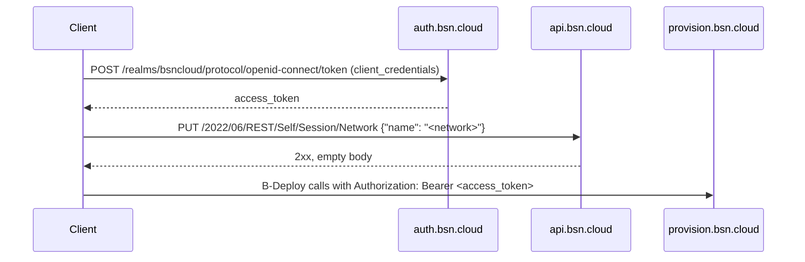

# B-Deploy API: migrating from v1 to v2/v3

v1 ([`v1Documentation.yaml`](../swagger/v1Documentation.yaml)) and v2/v3
([`bdeploy-v2-v3.yaml`](../swagger/bdeploy-v2-v3.yaml)) are different APIs. They
use different authentication and a different setup model, and the device API changes
behaviour. Both are hosted at `https://provision.bsn.cloud`. Server-side details are in
[`IMPLEMENTATION-NOTES.md`](IMPLEMENTATION-NOTES.md).

## Summary

| Area | v1 | v2 / v3 |
|---|---|---|
| Auth | `POST /rest/v1/authenticate` with a B-Deploy-local account → HS256 JWT (60 min) | BSN.cloud OAuth2 access token; network chosen via the BSN.cloud session |
| Device API | `/rest-device/v1/device` | `/rest-device/v2/device` (no v3) |
| Setup API | `/rest-setup/v1/setup` | `/rest-setup/v2/setup` (schema 2.0.0) or `/rest-setup/v3/setup` (schema 3.0.0, recommended) |
| Setup model | PascalCase BrightAuthor-era object (`PackageName`, `NetworkSettings`, ...) | `BsDsSetupParams` JSON (`bDeploy`, `setupType`, `version`, `network`, ...) |
| Scoping | by `client` = your v1 username | by the token's BSN.cloud network |
| Device `client` | always your v1 username | defaults to your OAuth client id |
| Envelope | `{error, result}` | same |

## 1. Authentication

v1:

```http
POST /rest/v1/authenticate
Content-Type: application/json

{"username": "...", "password": "..."}
→ {"error": null, "result": "<jwt>"}
```

v2/v3:



Without a session network, v2/v3 calls are rejected: 401 on the Node services; on the
C# service 403 "Token does not include a network", or 200 with
`{"error":"Error: Invalid user"}` on some device routes. Always check the `error` field,
not just the status.

## 2. Devices: `/rest-device/v1` → `/rest-device/v2`

Request and response shapes are the same (`serial`, `username`, `NetworkName`, `name`,
`model`, `desc`, `setupId`, `url`, `userdata`). The differences are behavioural:

- **Scoping:** results are limited to the token's network. A `NetworkName` filter for
  another network returns an empty list.
- **Writes:** PUT and DELETE on a device in another network return 403.
- **`client`:** not forced to your username; it defaults to the OAuth client id.
- **`NetworkName`:** send it on every create. It is needed for network-scoped access, and
  the C# service rejects a value that differs from the token's network.
- **Bulk delete:** `DELETE /device/ids/{idarray}` works in v2 for a non-empty array of
  id strings (Node returns a non-JSON 500 for an empty or malformed array). It is broken
  in v1.
- **Unchanged:** `setupId` is still never returned by GETs; use `setupName`.

## 3. Setups: `/rest-setup/v1` → `/rest-setup/v3`

The setup body must be rebuilt; there is no field-for-field rename. Field equivalents:

| v1 field | v3 field |
|---|---|
| `NetworkName` | `bDeploy.networkName` |
| `username` | `bDeploy.username` |
| `PackageName` | `bDeploy.packageName` |
| `Name` | `deviceName` |
| `Description` | `deviceDescription` |
| `TargetGroupName` | `bsnGroupName` |
| `TargetTimeZone` | `timeZone` (BrightSign code such as `PST`, not an IANA name) |
| `ScreenColor` (`RGB:rrggbb`) | `idleScreenColor` `{r,g,b,a}` |
| `NetworkSettings.TimeServer` | `network.timeServers[]` |
| `NetworkSettings.Hostname` | `network.hostname` |
| `NetworkSettings.ProxyServer` / `ProxyBypass` | `network.proxyServer` / `network.proxyBypass` |
| `NetworkSettings.Wired` / `Wireless` | entries in `network.interfaces[]` (`type` `Ethernet` / `WiFi`); a disabled wireless interface is simply absent |
| `UseDHCP`, `IpAddress` + `SubnetMask`, `DefaultGateway`, `DNS1`–`DNS3` (per interface) | `proto` (`DHCPv4` / `Static`), `ip[]` (CIDR), `gateway`, `dns[]` |
| Wireless `SSID` / `Passphrase` | `ssid`, `passphrase`, `security` |
| `WiredConnectionPriority` / `WirelessConnectionPriority` | interface `metric` |
| Per-interface rate limits and content/log/health flags | interface `rateLimit*`, `*DownloadEnabled`, `healthReportingEnabled`, `logsUploadEnabled` |
| `EnableNetworkDiagnostics`, `EnableEthernetTest`, `EnableWirelessTest`, `EnableInternetTest` | `networkDiagnosticsEnabled`, `test*Enabled` |
| `ConcatUnitNameAndSerial` | `unitNamingMethod` (`unitNameOnly` / `appendUnitIDToUnitName`) |
| `TargetBrightWallName`, `TargetBrightWallScreenNumber` | `BrightWallName`, `BrightWallScreenNumber` (string) |
| `SplashScreenUrl` | `useCustomSplashScreen` (boolean only; the URL is not carried over) |
| `ContentCheckPeriod` (duration) | `timeBetweenNetConnects` (seconds) |
| `ContentDownloadsStartTime` / `EndTime` | `contentDownloadsRestricted`, `contentDownloadRangeStart` / `contentDownloadRangeEnd` (minutes; check the End semantics against a known setup, it appears to be a length) |
| `LogsSettings.*` | `playbackLoggingEnabled`, `eventLoggingEnabled`, `diagnosticLoggingEnabled`, `stateLoggingEnabled`, `variableLoggingEnabled`, `uploadLogFilesAtBoot`, ... |
| `LogsSettings.UploadTime` | `uploadLogFilesAtSpecificTime` + `uploadLogFilesTime` |
| `RemoteSnapshotSettings.*` | `enableRemoteSnapshot`, `remoteSnapshotInterval`, `remoteSnapshotMaxImages`, `remoteSnapshotJpegQualityLevel`, `remoteSnapshotScreenOrientation` |
| `RemoteSnapshotSettings.CaptureInterval` (`"00:15:00"`) | `remoteSnapshotInterval` (integer; default 15, so most likely minutes) |
| `LocalWebServerSettings.*` | `lwsEnabled`, `lwsUserName`, `lwsPassword`, `lwsEnableUpdateNotifications` (plus `lwsConfig`) |
| `DiagnosticWebServerSettings.*` | `dwsEnabled`, `dwsPassword` |
| `FirmwareVersion` / `FirmwareURL` | `firmwareUpdatesByFamily.<Family>` + `firmwareUpdateType` |
| `Login` / `Password` (BSN) | no equivalent: obtain a registration token and send `bsnDeviceRegistrationTokenEntity` (required for `setupType: "bsn"`) |
| `bsnDeviceRegistrationTokenEntity` | same name and shape |
| `HealthReporting*` | no 3.0.0 field (only legacy `heartbeats*` / `timeBetweenHeartbeats`) |
| `Beacons`, `Model` | dropped; no 3.0.0 equivalent |
| — | `setupType`: `partnerApplication`, `bsn`, `standalone`, `lfn`, `sfn` work on both servers; avoid `legacyLfn` and `localToBsn` (the C# service rejects them) |
| — | `bDeploy.url` (partner application URL) |

Behaviour changes:

- **Uniqueness:** `bDeploy.packageName` must be unique per network (v1: per client + network).
- **POST defaults:** POST merges server defaults for omitted top-level fields; PUT does
  not on Node (C# merges on PUT too). Defaults turn on `lwsEnabled`, `remoteDwsEnabled`,
  `bsnCloudEnabled` and `inheritNetworkProperties`, so send `false` for anything the v1
  setup had off.
- **List responses:** a list returns stored records with `setupJson` as a JSON string
  (v1 returned `{total, matched, deviceSetups, priv}`). Always name the network.
- **Get by id:** use `GET /setup/{id}`; it returns a one-element array (v1 returned the
  object). Don't use `?_id=`: the C# service ignores it and returns the list.
- **PUT response:** returns an update result (v1 returned `true`).
- **Registration tokens on C#:** the C# service requires `bsnDeviceRegistrationTokenEntity`
  for any `bDeploy.username` containing `brightsign`, `bsn` or `bacon`
  (case-insensitive), whatever the `setupType`. Test with the account you will really use.

## 4. Checklist

- [ ] Replace v1 authentication with BSN.cloud OAuth2, and set the session network.
- [ ] Repoint `/rest-device/v1` → `/rest-device/v2` and `/rest-setup/v1` → `/rest-setup/v3`.
- [ ] Send `NetworkName` on every device create.
- [ ] Rebuild setup payloads as 3.0.0 JSON (section 3).
- [ ] Parse setup lists as records with a string `setupJson`, and get-by-id as a one-element array.
- [ ] Filter setup lists with `query[...]`, always naming the network, and send `pageSize` explicitly.
- [ ] Get a single setup with `GET /rest-setup/v3/setup/{id}`, not `?_id=`.
- [ ] Treat ids as opaque strings (24-hex or decimal).
- [ ] Send serials upper-case; always pass `NetworkName` on device lists.
- [ ] Device PUT: GET, modify, PUT the complete record with `_id` and `serial`.
- [ ] Setup POST: send `false` for defaulted-on features the v1 setup had off.
- [ ] Re-read after PUT if you need the stored object.
