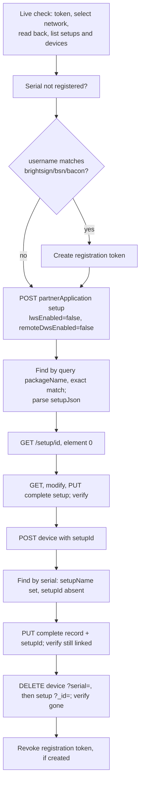

# B-Deploy v2/v3 test client (Python)

A standard-library Python client for B-Deploy v2/v3 and the BSN.cloud calls it depends
on, plus two live test scenarios. Built only from this repository's
[API guide](../docs/BDEPLOY-API-GUIDE.md), [implementation notes](../docs/IMPLEMENTATION-NOTES.md)
and [specs](../swagger/). Requires Python 3.10+; nothing to install.

## Layout

| Path | Purpose |
|---|---|
| `bdeploy/client.py` | `BDeployClient`: token, session network, registration tokens, setups (`/rest-setup/v3`), devices (`/rest-device/v2`) |
| `bdeploy/scenarios.py` | `run_live_check` (read-only) and `run_lifecycle` (create, update, delete, with cleanup) |
| `bdeploy/__main__.py` | CLI: `python -m bdeploy check` or `python -m bdeploy lifecycle` |
| `tests/fake_bsn.py` | In-process fake of auth, Main API and the C# B-Deploy service, for offline tests |
| `tests/test_*.py` | Offline unit tests (`make test`) |

## Usage

```bash
export BS_CLIENT_ID=<client id> BS_SECRET=<secret> BS_NETWORK=<network name>
make live-check            # read-only: guide section 4

export BS_USERNAME=<account e-mail>
make lifecycle             # live check, then a throwaway setup + device

make run-tests             # offline: build + unit tests against the fake server
```

| Variable | Needed for |
|---|---|
| `BS_CLIENT_ID`, `BS_SECRET`, `BS_NETWORK` | everything |
| `BS_USERNAME` | `lifecycle` |

The client always talks to the production hosts. For `lifecycle`, `--serial` picks the
serial to register (default: a random `ZZ`-prefixed serial) and `--url` sets the
temporary setup's application URL (default: a placeholder). Run
`python -m bdeploy lifecycle --help` from `src/` for details.

Exit codes: `0` all steps passed, `1` a step failed, `2` configuration error.

## What the lifecycle does



- The package name is `bdeploy-test-client-<UTC timestamp>-<random>`.
- If the serial is already registered in the network, the run stops without changing
  anything.
- Only records the run created are deleted. If a step fails, the remaining cleanup runs
  newest-first (device, then setup, then token). Each cleanup is reported as a step.
- Usernames containing `brightsign`, `bsn` or `bacon` make the C# service demand a
  registration token even for `partnerApplication`. The run creates and revokes one.

## Rules the client follows

From the guide's [pitfalls checklist](../docs/BDEPLOY-API-GUIDE.md#14-pitfalls-checklist):

- **Headers.** Every request sends `Accept: application/json` and its own `User-Agent`;
  POST and PUT bodies send exactly `Content-Type: application/json`.
- **Failures.** Redirects are not followed, and every non-2xx (3xx included) raises
  `ApiError`. A non-null envelope `error` also raises, even on a 200.
- **Tokens.** A token is refreshed 30s before `expires_in`, and the session network is
  selected again after every new token. A 401 gets one re-authentication and retry; a 403
  is never retried.
- **Rate limits.** A 429 is retried (honouring `Retry-After`) only on GET and DELETE;
  POST and PUT are never retried.
- **Paging.** `pageSize` is always sent, and pages are read until one comes back short.
  A page larger than `pageSize` raises.
- **Lists.** Setup filters use `query[...]`, and every list sends `NetworkName`. Name
  look-ups compare `packageName` exactly and return every match.
- **Setup GETs.** Get-by-id uses the path form and returns element 0; list records'
  `setupJson` is parsed from a string.
- **Serials.** They are upper-cased and must be 12 characters.
- **Hosts.** Plain `http` is rejected except for `localhost`/`127.0.0.1` (the test fake).

## Limits

- The offline fake models the documented **C#** behaviour only. The Node differences in
  `IMPLEMENTATION-NOTES.md` are handled by the client's general rules (status class,
  `error` field, opaque ids), but there is no Node fake.
- The client has not yet been run against a live service.
- Array-body creates (several setups or devices in one POST) and the v2 setup routes
  are not implemented.
